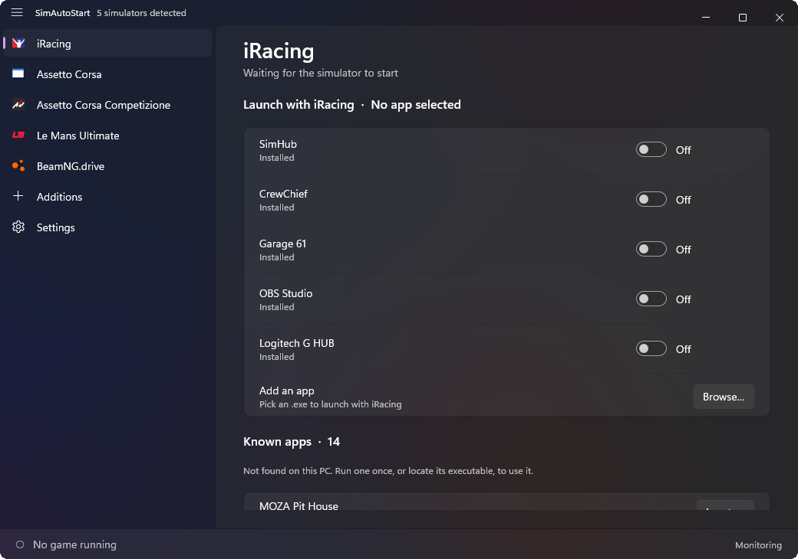
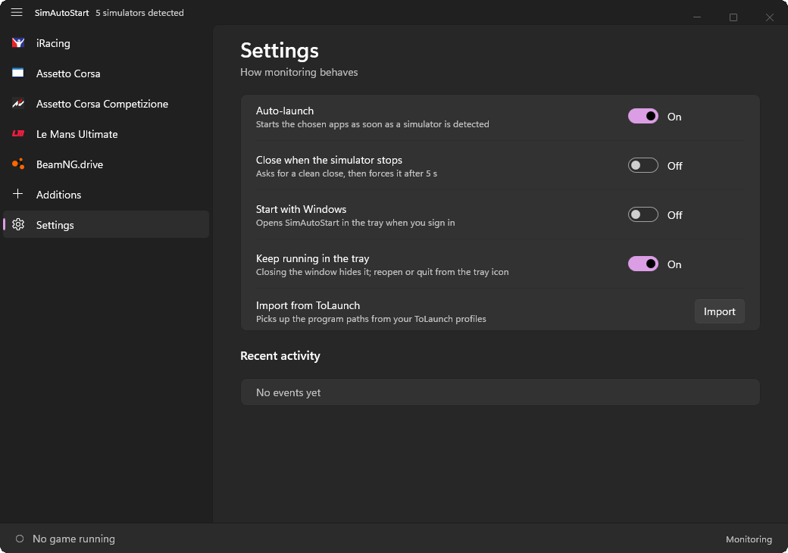

# SimAutoStart

Détecte les jeux de simracing installés sur ton PC et **lance les applications compagnons que tu choisis dès qu'un jeu démarre** (SimHub, CrewChief, Garage 61, Trading Paints, Track Titan…), puis les ferme quand le jeu s'arrête.

Application Windows 11 native écrite en **Rust** avec **WinUI 3** ([`windows-reactor`](https://github.com/microsoft/windows-rs/pull/4479)), fond Mica, légère (environ 3,6 Mo, aucun framework à embarquer).

> 🇬🇧 [English version](README.md)

| Choisir les applis de chaque jeu | Réglages |
| --- | --- |
|  |  |

L'interface s'affiche en français quand Windows est en français (en anglais sinon) ; les captures sont en anglais.

## Fonctionnalités

- **Détection automatique des jeux** : jeux Steam (lus dans les manifestes des bibliothèques Steam, donc les dossiers résiduels ne comptent pas), jeux hors Steam via la liste « Applications installées » de Windows (iRacing par exemple), et tes propres ajouts.
- **Une page par jeu** avec un interrupteur par application. Les applis absentes du PC sont regroupées dans une case **Apps connues**, avec un bouton *Localiser…*.
- **Lancement au démarrage du jeu, fermeture à son arrêt** (optionnelle) : demande de fermeture propre d'abord, arrêt forcé après 5 s.
- **Logos des jeux** extraits de leur exécutable.
- **Ajoute tes propres jeux et applis** depuis un `.exe` (page *Ajouts*, ou *Ajouter une application* sur la page d'un jeu).
- **Zone de notification** : fermer la fenêtre la cache (menu Ouvrir / Quitter), et une seule instance tourne à la fois.
- **Démarrage avec Windows** (démarre caché dans la zone de notification).
- **Barre du bas** indiquant le jeu en cours.
- Importe les chemins de tes profils [ToLaunch](https://github.com/tolgayilmaz86/ToLaunch) (`%LOCALAPPDATA%\ToLaunch`).

### Jeux et applications du catalogue

| Jeux | Applications compagnons |
| --- | --- |
| iRacing, Assetto Corsa, Assetto Corsa Competizione, Le Mans Ultimate, rFactor 2, Automobilista 2, RaceRoom, EA SPORTS WRC, DiRT Rally 2.0, F1 25, BeamNG.drive | SimHub, CrewChief, MOZA Pit House, Garage 61 (iRacing seulement), Content Manager (Assetto Corsa seulement), Trading Paints (iRacing seulement), RaceLab, VoiceAttack, Fanatec FanaLab, OBS Studio, Kapps, Track Titan, Coach Dave Delta, Z1 Dashboard, Simucube True Drive, OpenKneeboard, HWiNFO, MSI Afterburner, Logitech G HUB, Sim Racing Studio |

> **À savoir :** les noms d'exécutables de plusieurs applications viennent de documentations publiques ou de mémoire et n'ont pas tous été confirmés sur une machine qui les a installées : Track Titan, Coach Dave Delta, Z1 Dashboard, Simucube True Drive et Sim Racing Studio surtout. Si l'un est faux, utilise **Localiser…** une fois : l'appli retient le vrai chemin et le vrai nom de processus. Les corrections sont les bienvenues (`src/catalog.rs`).

## Fonctionnement

1. Chaque seconde, les processus en cours sont comparés à la liste des jeux. Un jeu est « en cours » dès qu'un de ses processus existe (pour iRacing, cela inclut le lanceur `iRacingUI`, celui qu'on ouvre en premier).
2. Quand un jeu apparaît, les applis activées pour lui sont lancées (si elles ne tournent pas déjà). Quand il disparaît, celles que SimAutoStart a lancées sont fermées (si l'option est active).
3. Les chemins sont **appris** : depuis les processus en cours, depuis tes profils ToLaunch et depuis *Localiser…*. Le catalogue ne contient que des emplacements par défaut.

Les réglages et caches sont dans `%LOCALAPPDATA%\SimAutoStart` (`config.json`, `icons\`, `software.txt`). Rien n'est envoyé nulle part.

## Prérequis

- Windows 10 1809 ou plus récent (Windows 11 recommandé : fond Mica)
- [Runtime Windows App SDK 2.x](https://learn.microsoft.com/windows/apps/windows-app-sdk/downloads) (déjà présent avec beaucoup d'applications récentes)

## Compiler

Il faut la [chaîne d'outils Rust](https://rustup.rs) (cible MSVC) et les Build Tools de Visual Studio avec le **SDK Windows** (pour `rc.exe`, qui compile la ressource d'icône). Python n'est **pas** nécessaire.

```powershell
git clone https://github.com/fraustiz/SimAutoStart
cd SimAutoStart
cargo run --release
```

L'exécutable est `target\release\simautostart.exe`. `cargo test` lance le test d'aller-retour du registre pour *Démarrer avec Windows* (il écrit dans `HKCU\...\Run` puis remet l'état précédent).

## Limites connues

- `windows-reactor` est une préversion (0.100). L'icône de notification, l'interception de la fermeture et le sélecteur de fichier passent par du Win32 et PowerShell, faute de mieux dans le crate.
- Un jeu doit être détectable : Steam, liste des applications installées, chemin par défaut, ou ajouté à la main.
- Le premier lancement lit la liste des applications installées et extrait les logos (environ une seconde) ; tout est ensuite mis en cache.

## Crédits

- Construit sur [`windows-reactor`](https://github.com/microsoft/windows-rs) de Microsoft.
- Inspiré de [ToLaunch](https://github.com/tolgayilmaz86/ToLaunch) et d'iRacingManager, qui répondaient au même besoin avec des profils manuels.

## Licence

[MIT](LICENSE) © 2026 Fraustiz.
