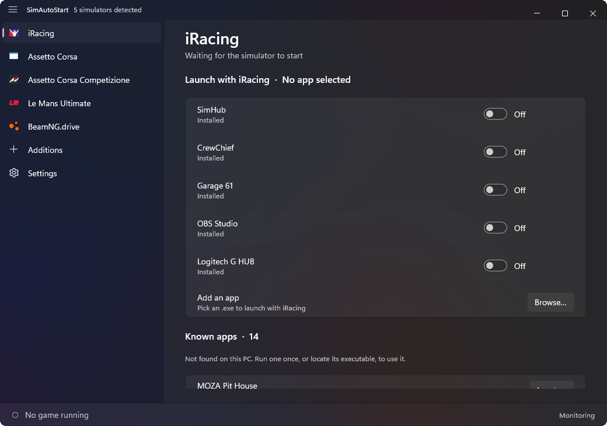
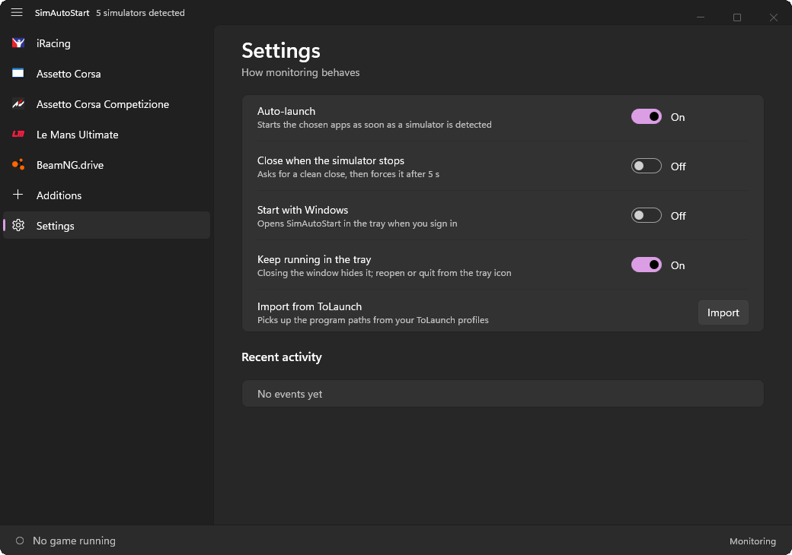

# SimAutoStart

Detects the sim racing games installed on your PC and **launches the companion apps you choose the moment a game starts** (SimHub, CrewChief, Garage 61, Trading Paints, Track Titan…), then closes them when the game stops.

Native Windows 11 app written in **Rust** with **WinUI 3** ([`windows-reactor`](https://github.com/microsoft/windows-rs/pull/4479)), Mica backdrop, light on resources (about 3.6 MB, no framework to ship).

> 🇫🇷 [Version française](README.fr.md)

| Pick the apps for each game | Settings |
| --- | --- |
|  |  |

## Features

- **Automatic game detection**: Steam games (read from the Steam library manifests, so leftover folders don't count), non-Steam games via Windows' installed-programs list (iRacing, for example), and your own additions.
- **One page per game** with a switch for each companion app. Apps that are not on the PC are grouped in a **Known apps** box with a *Locate…* button.
- **Launches on game start, closes on game stop** (optional): a clean close request first, a forced close after 5 s.
- **Game logos** extracted from each game's executable.
- **Add your own** games and apps from an `.exe` (page *Additions*, or *Add an app* on any game page).
- **System tray**: closing the window hides it in the notification area (menu: Open / Quit), and only one instance ever runs.
- **Start with Windows** (starts hidden in the tray).
- **Bottom bar** showing which game is running.
- English by default, **French automatically** when Windows is displayed in French.
- Imports program paths from [ToLaunch](https://github.com/tolgayilmaz86/ToLaunch) profiles (`%LOCALAPPDATA%\ToLaunch`).

### Games and apps in the catalog

| Games | Companion apps |
| --- | --- |
| iRacing, Assetto Corsa, Assetto Corsa Competizione, Le Mans Ultimate, rFactor 2, Automobilista 2, RaceRoom, EA SPORTS WRC, DiRT Rally 2.0, F1 25, BeamNG.drive | SimHub, CrewChief, MOZA Pit House, Garage 61 (iRacing only), Content Manager (Assetto Corsa only), Trading Paints (iRacing only), RaceLab, VoiceAttack, Fanatec FanaLab, OBS Studio, Kapps, Track Titan, Coach Dave Delta, Z1 Dashboard, Simucube True Drive, OpenKneeboard, HWiNFO, MSI Afterburner, Logitech G HUB, Sim Racing Studio |

> **Heads-up:** the executable names of several apps come from public documentation or from memory and have not all been confirmed on a machine that has them installed: Track Titan, Coach Dave Delta, Z1 Dashboard, Simucube True Drive and Sim Racing Studio in particular. If one is wrong, use **Locate…** once: the app remembers the real path and process name. Pull requests with the right names are welcome (`src/catalog.rs`).

## How it works

1. Every second, the running processes are compared to the game list. A game counts as running as soon as one of its processes exists (for iRacing that includes the `iRacingUI` launcher, which is what you open first).
2. When a game appears, the apps you switched on for it are started (if they aren't already running). When it disappears, the ones SimAutoStart started are closed (if you enabled that).
3. Paths are **learned**: from running processes, from your ToLaunch profiles, and from *Locate…*. The catalog only holds default locations.

Settings and caches live in `%LOCALAPPDATA%\SimAutoStart` (`config.json`, `icons\`, `software.txt`). Nothing is sent anywhere.

## Requirements

- Windows 10 1809 or later (Windows 11 recommended: Mica backdrop)
- [Windows App SDK runtime 2.x](https://learn.microsoft.com/windows/apps/windows-app-sdk/downloads) (already installed with many recent apps)

## Build

You need the [Rust toolchain](https://rustup.rs) (MSVC target), the Visual Studio Build Tools with the **Windows SDK** (for the icon resource compiler `rc.exe`), and Python is **not** required.

```powershell
git clone https://github.com/fraustiz/SimAutoStart
cd SimAutoStart
cargo run --release
```

The executable is `target\release\simautostart.exe`. Run `cargo test` for the registry round-trip test of *Start with Windows* (it writes to `HKCU\...\Run` and restores the previous state).

## Project layout

| File | Role |
| --- | --- |
| `src/main.rs` | The UI (WinUI 3 through `windows-reactor`): sidebar, pages, status bar |
| `src/catalog.rs` | Built-in games and apps, plus the runtime registry for custom entries |
| `src/detect.rs` | Installed games (Steam manifests, installed-programs list), running processes, ToLaunch import |
| `src/engine.rs` | Monitoring thread: launches and closes apps |
| `src/tray.rs` | Notification-area icon, close-to-tray, single instance (raw Win32) |
| `src/autostart.rs` | *Start with Windows* (registry `Run` key) |
| `src/icons.rs` | Game logo extraction and cache |
| `src/custom.rs` | Custom games/apps and the file picker |
| `src/config.rs`, `src/i18n.rs` | Persisted settings; English/French |
| `assets/` | App icon (minimal play triangle) |

## Known limitations

- `windows-reactor` is a preview crate (0.100). The tray icon, close interception and file picker are implemented with plain Win32 and PowerShell because the crate doesn't offer them yet.
- A game has to be detectable: Steam, the Windows installed-programs list, a default path, or added by hand.
- The first launch reads the installed-programs list and extracts logos (about a second); both are cached afterwards.

## Credits

- Built on [`windows-reactor`](https://github.com/microsoft/windows-rs) by Microsoft.
- Inspired by [ToLaunch](https://github.com/tolgayilmaz86/ToLaunch) and iRacingManager, which solved the same problem with manual profiles.

## License

No license has been chosen yet: all rights reserved by the author until one is added.
